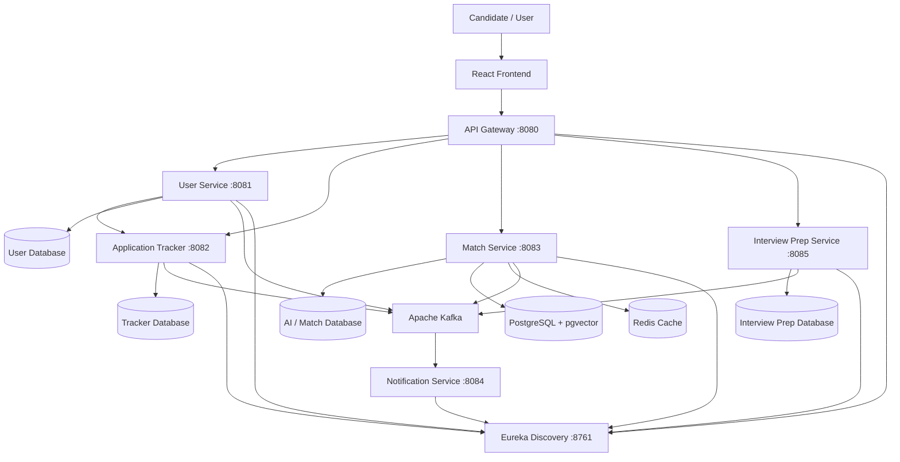

# JobFit AI — Intelligent Resume Matching & Job Application Management Platform

> An AI-powered job search platform that helps candidates manage applications, discover skill gaps, match resumes against job descriptions, and prepare for interviews through a distributed Spring Boot microservices architecture.

[](https://www.oracle.com/java/)
[](https://spring.io/projects/spring-boot)
[](https://react.dev/)
[](#architecture)

## Overview

JobFit AI is a full-stack job application intelligence platform designed to simplify and improve the job search process.

It combines resume management, application tracking, AI-powered semantic resume matching, skill-gap analysis, and interview preparation in one platform.

The backend is built using Java 17 and Spring Boot 3, with independently developed microservices communicating through REST APIs and Kafka-based event-driven messaging. AI-powered matching uses vector embeddings and semantic similarity rather than relying only on keyword matching.

The project demonstrates practical implementation of microservices, distributed communication, authentication, caching, event-driven architecture, fault tolerance, and AI integration.

## Architecture



### Architecture Overview

- **API Gateway:** Central entry point for frontend requests and backend routing.
- **Eureka Server:** Service discovery and registration.
- **User Service:** User registration, authentication, profile and resume-related functionality.
- **Application Tracker Service:** Job application management, status tracking, statistics and recent activity.
- **Match Service:** Semantic resume-to-job-description matching and skill-gap analysis.
- **Interview Prep Service:** Interview preparation functionality.
- **Notification Service:** Handles notification-related workflows.
- **React Frontend:** User-facing application dashboard and interface.
- **Kafka:** Event-driven communication between services.
- **PostgreSQL / pgvector:** Persistent data storage and vector similarity search.
- **Redis:** Caching for frequently requested data.

## Service Repositories

All services are maintained in independent GitHub repositories.

| Service | Repository | Responsibility |
|---|---|---|
| User Service | [resume-job-tracker](https://github.com/learnWithNishu/resume-job-tracker) | Authentication, user profiles and resume management |
| Application Tracker | [application-tracker-service](https://github.com/codewithnishu221/application-tracker-service) | Job applications, status tracking and statistics |
| Match Service | [match-service](https://github.com/codewithnishu221/match-service) | AI-powered resume matching and skill-gap analysis |
| Notification Service | [notification-service](https://github.com/codewithnishu221/notification-service) | Event-driven notification processing |
| Interview Prep Service | [interview-prep-service](https://github.com/codewithnishu221/interview-prep-service) | Interview preparation functionality |
| Service Discovery | [eureka-server](https://github.com/codewithnishu221/eureka-server) | Service registration and discovery |
| API Gateway | [api-gateway](https://github.com/codewithnishu221/api-gateway) | Centralized routing for backend services |
| Frontend | [jobfit-ai-frontend](https://github.com/codewithnishu221/jobfit-ai-frontend) | React-based user interface |

## Key Features

- **Resume Management:** Upload and manage candidate resumes.
- **Job Application Tracking:** Track applications and monitor their statuses.
- **Semantic Resume Matching:** Compare resumes and job descriptions using vector embeddings.
- **Skill-Gap Analysis:** Identify missing or insufficient skills beyond simple keyword matching.
- **Interview Preparation:** Support interview preparation workflows.
- **Event-Driven Notifications:** Use Kafka to decouple notification processing from application workflows.
- **Centralized API Routing:** Route frontend requests through Spring Cloud Gateway.
- **Service Discovery:** Register and discover backend services using Netflix Eureka.
- **Caching:** Use Redis to reduce repeated computation and database access.
- **Fault Tolerance:** Apply Resilience4j circuit breakers to protect service communication.

## Tech Stack

| Layer | Technologies |
|---|---|
| Backend | Java 17, Spring Boot 3 |
| Microservices | Spring Cloud, Eureka, API Gateway |
| API Communication | REST APIs, OpenFeign / RestClient where implemented |
| Security | Spring Security, JWT |
| Persistence | Spring Data JPA, Hibernate |
| Databases | PostgreSQL |
| Vector Database | pgvector |
| Messaging | Apache Kafka |
| Caching | Redis |
| AI / LLM | Ollama, Llama 3.2, nomic-embed-text, OpenAI APIs |
| AI Integration | Spring AI, RAG, vector embeddings |
| Resilience | Resilience4j |
| Frontend | React 18, Vite, JavaScript |
| Frontend Libraries | Axios, React Router, Tailwind CSS, TanStack React Query |
| Build Tools | Maven, npm |
| DevOps | Docker, GitHub Actions |
| Monitoring | Micrometer, Prometheus, Grafana |

## Design Decisions & Trade-offs

### 1. Microservices Architecture

The platform separates responsibilities into independent services rather than maintaining one large monolithic backend.

**Why?**
- Independent development and deployment.
- Clear ownership of business responsibilities.
- Better isolation of service-specific failures.
- Easier scaling of resource-intensive functionality.

**Trade-off:** More infrastructure, service discovery, inter-service communication, and deployment complexity.

### 2. Kafka for Event-Driven Communication

Kafka supports asynchronous communication between services and helps decouple event producers from consumers.

**Why?**
- Services do not need to wait for downstream event processing.
- Multiple consumers can process relevant events independently.
- Supports scalable event-driven workflows.

**Trade-off:** Introduces additional infrastructure and requires careful handling of retries, duplicate events, and eventual consistency.

### 3. pgvector for Semantic Search

Traditional keyword matching can miss relevant resumes when candidates describe similar skills using different terminology.

The matching workflow uses embeddings to represent resume and job-description content as vectors, then applies cosine similarity to find semantically relevant matches.

**Trade-off:** Embedding generation adds processing cost and latency, and match quality depends on the embedding model and input quality.

### 4. Redis for Caching

Redis is used to cache frequently requested results and reduce repeated processing.

**Trade-off:** Cache invalidation and consistency must be considered when underlying application data changes.

### 5. Resilience4j for Fault Tolerance

Circuit breakers help prevent repeated calls to an unhealthy downstream service and support recovery when that service becomes available again.

**Trade-off:** Fallback behavior must be designed carefully so that temporary service failures are not mistaken for valid business results.

## Performance

The following are project-reported development results. Exact benchmarking conditions and repeatable load-test reports should be documented separately before treating them as formal production benchmarks.

| Metric | Before | After |
|---|---:|---:|
| Repeated match-query response time | ~180 ms | ~20 ms with Redis caching |
| Repeated match-query load | Baseline | Approximately 85% lower, as reported |
| Semantic similarity scoring | — | Sub-second scoring |
| Background JD embedding and matching workflow | — | Under 2 seconds, as reported |

## Getting Started

### Prerequisites

Install the following tools before running the application:

- Java 17
- Maven 3.9+
- Node.js and npm
- PostgreSQL
- Redis
- Apache Kafka
- Git
- Docker (for running infrastructure dependencies)
- Ollama, if running the local embedding/LLM workflow

### Clone the Repositories

Clone the parent repository first:

```bash
git clone https://github.com/codewithnishu221/jobfit-ai.git
cd jobfit-ai
```

Clone the individual service repositories:

```bash
git clone https://github.com/codewithnishu221/eureka-server.git
git clone https://github.com/codewithnishu221/api-gateway.git
git clone https://github.com/learnWithNishu/resume-job-tracker.git
git clone https://github.com/learnWithNishu/application-tracker-service.git
git clone https://github.com/codewithnishu221/match-service.git
git clone https://github.com/codewithnishu221/notification-service.git
git clone https://github.com/codewithnishu221/interview-prep-service.git
git clone https://github.com/codewithnishu221/jobfit-ai-frontend.git
```

### Configure Environment Variables

Configure each service's database connection, credentials, JWT settings, Kafka bootstrap address, Redis connection, and any required AI model/API settings.

Use the individual service repositories' configuration files as the source of truth. Do not commit real credentials or API keys.

### Start the Infrastructure

Start PostgreSQL, Redis and Kafka using your local installations or Docker containers.

Make sure the databases, schemas, credentials, and Kafka topics required by the individual services are configured.

### Start Services in Order

Start the backend services in separate terminals. The following is the recommended startup order:

| Order | Service | Port |
|---:|---|---:|
| 1 | Eureka Server | 8761 |
| 2 | Application Tracker Service | 8082 |
| 3 | User Service | 8081 |
| 4 | Match Service | 8083 |
| 5 | Notification Service | 8084 |
| 6 | Interview Prep Service | 8085 |
| 7 | API Gateway | 8080 |
| 8 | React Frontend | 5173 |

For each Spring Boot service:

```bash
./mvnw spring-boot:run
```

On Windows, use:

```powershell
.\mvnw.cmd spring-boot:run
```

For the frontend:

```bash
npm install
npm run dev
```

Open the frontend at:

```text
http://localhost:5173
```

Open the Eureka dashboard at:

```text
http://localhost:8761
```

**Note:** Start infrastructure dependencies before the services that use them. Ensure all service-specific environment variables and database configurations are set. The order above is a suggested startup sequence, not a substitute for verifying each service's actual dependencies.

### Docker Compose

A unified root-level Docker Compose deployment is not documented in this repository yet.

Once a root orchestration configuration is implemented, the intended workflow will be:

```bash
docker compose up --build -d
```

And to stop the system:

```bash
docker compose down
```

These commands are planned for the future unified deployment setup; they should not be treated as currently working until a root-level Compose file has been added and tested.

## API Examples

All frontend requests should use the API Gateway rather than calling individual backend services directly.

**Example: Check the User Service profile endpoint**

```bash
curl -X GET http://localhost:8080/api/users/profile \
  -H "Authorization: Bearer <YOUR_JWT_TOKEN>"
```

**Example: Application Tracker API**

Use the actual endpoint and request body defined in the Application Tracker Service repository:

```bash
curl -X GET http://localhost:8080/<APPLICATION_TRACKER_ENDPOINT> \
  -H "Authorization: Bearer <YOUR_JWT_TOKEN>"
```

See the individual service repositories for their complete endpoint definitions and request/response DTOs.

## Testing

### Backend Tests

Run the following command from each Spring Boot service repository:

```bash
./mvnw test
```

On Windows:

```powershell
.\mvnw.cmd test
```

### Frontend Build

From the frontend repository:

```bash
npm install
npm run build
```

Run frontend tests using the test script configured in its `package.json`, if available.

### Integration Testing

Verify the following workflows:

- User registration and login.
- JWT-protected profile access.
- Resume upload and retrieval.
- Job application creation and status updates.
- Application statistics and recent activity.
- Resume-to-job-description matching.
- Kafka event production and consumption.
- Notification processing.
- Service registration and discovery through Eureka.

## Future Improvements

- Unified Docker Compose deployment for the complete platform.
- Kubernetes deployment and service orchestration.
- Automated integration and end-to-end testing.
- Centralized logging and distributed tracing.
- Improved observability and monitoring dashboards.
- More advanced AI-powered interview preparation.
- Improved recommendation quality and evaluation of semantic matching.
- CI/CD pipelines for independent service deployments.
- Production-grade secrets management and service-to-service security.

## Project Structure

The project is maintained as multiple independent repositories:

```text
jobfit-ai/
│
├── README.md
│
├── resume-job-tracker/
├── application-tracker-service/
├── match-service/
├── notification-service/
├── interview-prep-service/
├── eureka-server/
├── api-gateway/
└── jobfit-ai-frontend/
```

The folders above represent the logical repository organization. Each service is maintained in its own GitHub repository; they are not nested inside this parent repository.

---

**Project:** JobFit AI  
**Architecture:** Distributed Microservices  
**Backend:** Java 17 · Spring Boot 3  
**Frontend:** React 18  
**Repository Hub:** [github.com/codewithnishu221/jobfit-ai](https://github.com/codewithnishu221/jobfit-ai)
